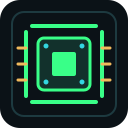

# Chip Architect

**2D-песочница на Godot 4.4+ (GDScript): собери чип из любых компонентов, напиши для него программу и сыграй в неё прямо на экране вывода.**

Чип может быть под что угодно — аркадный автомат, холодильник, суперкомпьютер. Игра не ограничивает назначение: только физика схемы (питание, тепло, стабильность, пропускная способность шины) и ваша фантазия.



---

## Что уже работает

| Блок | Возможности |
| --- | --- |
| **Бесконечное поле** | Сетка с плавным зумом, панорама ПКМ/СКМ/WASD, привязка к клеткам, поворот на 90°, перетаскивание, автотрассировка ортогональных дорожек (A*), проверка коллизий |
| **Компоненты** | 14 data-driven деталей: БП, VRM, конденсатор, GPU, CPU, VRAM, NAND + контроллер, XON-мост, 2 кулера, крио-плита, тактовый генератор, отладочный зонд, Display Out |
| **Валидация** | Пути питания, шины, видеосигнала, достаточность ватт/охлаждения/памяти. Ошибки и предупреждения с подсказками, сборку **не блокируют** |
| **Мини-IDE** | CodeEdit с подсветкой ChipScript, номера строк, примеры, шпаргалка, консоль `print`, подсветка строк с ошибками |
| **Программа чипа** | Свой безопасный интерпретатор (не `eval`): функции, массивы, циклы, ввод, рисование. Бюджет инструкций зависит от мощности чипа |
| **Экран вывода** | Отдельная панель: SubViewport → TextureRect, живой FPS, питание, температура, стабильность, шина. Шейдерные артефакты при перегреве/нестабильности, «нет сигнала», «программа упала» |
| **Ввод** | Мышь (клики, позиция, перетаскивание) **и все клавиши** (буквы, цифры, стрелки, F1–F12, модификаторы, пробел...) пробрасываются в SubViewport через `push_input()` — координаты пересчитываются в виртуальные 320×180 |
| **Полный экран** | Кнопка «РАЗВЕРНУТЬ» и F11; Esc — выход |
| **Сохранение** | Схема + код в один JSON (Ctrl+S / Ctrl+O) |
| **Симуляция** | Питание → FPS, шина → FPS, стабильность → глитчи, тепло → троттлинг, качество рендера (160×90 … 400×225) зависит от мощности |

---

## Запуск

1. Установите [Godot 4.4+](https://godotengine.org/download) (обычная версия, не .NET).
2. `Import` → выберите `project.godot` в корне репозитория → `Import & Edit`.
3. Нажмите **F5** (Run Project). Откроется демо-чип с готовой программой.

Или из консоли:

```bash
godot --path . 
```

Headless-тесты (нужен тот же Godot; первый запуск импортирует проект и создаёт кэш классов):

```bash
godot --headless --path . --import
godot --headless --path . --script tests/headless_tests.gd
```

Тесты проверяют парсер и VM (математика, массивы, циклы, ввод, лимиты), автотрассировку, сериализацию, валидатор, все примеры, сборку главной сцены, RUN/STOP, полноэкранный режим и сохранение/загрузку.

---

## Управление

### Поле чипа

| Действие | Как |
| --- | --- |
| Выбрать компонент | ЛКМ по карточке в «Палитре» |
| Поставить | ЛКМ по свободной клетке (можно ставить несколько подряд) или перетащить карточку из палитры |
| Выбрать / перетащить | ЛКМ по компоненту и тянуть |
| Повернуть на 90° | `R` (компонент под курсором / выбранный / призрак установки) |
| Соединить порты | ЛКМ по цветному порту, затем по другому порту того же типа (или тянуть) |
| Отменить режим | `Esc` |
| Удалить | `Del` или `X` |
| Панорама | ПКМ / СКМ, `WASD` / стрелки |
| Зум | Колесо мыши (к курсору), кнопки `−` / `+` |
| Показать всю плату | `F` или `FIT` |
| Повернуть под курсором | короткий клик ПКМ |

Типы портов: **питание** (жёлтый), **шина** (голубой), **видео** (розовый). Соединять можно только одинаковые типы. Один порт может ветвиться — как дорожка на печатной плате.

### Программа и экран

| Действие | Как |
| --- | --- |
| Запустить | `F5` / `Ctrl+Enter`, кнопка **RUN** (в шапке или на экране) |
| Остановить | Кнопка **STOP** |
| Перезапустить | **СБРОС** на экране вывода (программа стартует заново) |
| Полный экран | `F11` / кнопка «РАЗВЕРНУТЬ», `Esc` — выход |
| Сохранить / загрузить | `Ctrl+S` / `Ctrl+O` |
| Помощь | `F1` или кнопка `?` |

Пока курсор находится над экраном вывода, **все** клавиши и клики уходят в программу чипа — редактор их не получает.

---

## Как собрать рабочий чип

1. **Питание.** Поставьте `Power In` (520 Вт) и при необходимости `VRM Stage` (+320 Вт). Соедините порты питания с ядрами, памятью и кулерами.
2. **Вычисления.** `GPU Core` (150 compute) или `CPU Core` (80 compute).
3. **Память.** Шина: `VRAM` (+120 к пропускной способности), `XON Bridge` (+100), `NAND Controller` (+70), `NAND Flash` (+30). Ядро без шины работает на 15% мощности.
4. **Видео.** Соедините `VID` ядра с `Display Out`.
5. **Охлаждение.** `Cooler Fan` отводит 160 Вт, `Cryo Plate` — 320 Вт (но ест 110 Вт).
6. **Стабильность.** Конденсаторы, VRM, XON, отладочный зонд и клок-генератор уменьшают артефакты.

Компоненты с проблемами помечены красным значком **!** — наведите на них мышь, чтобы
увидеть причину в строке состояния. Панель **«ВАЛИДАЦИЯ СХЕМЫ»** сразу объясняет, чего не хватает. Даже нерабочий чип можно запустить — и увидеть «нет сигнала», низкий FPS или глитчи.

### Как считается производительность

* `power_satisfaction = min(1, сумма supply / сумма draw)` на сети питания;
* пропускная способность: `demand = Σ compute × 0.85`, `ratio = min(1, Σ bandwidth / demand)`;
* `stability = 0.86 + бонусы − дефицит питания − голод шины − перегрев` (0.3…1.0);
* `compute_effective = Σ compute × power_ratio × bus_ratio`;
* `fps = clamp(6 + compute_effective × stability × thermal × 0.33, 6, 60)`;
* качество рендера: `<40` → 160×90, `<90` → 240×135, `<170` → 320×180, иначе 400×225;
* бюджет инструкций VM: `1200 + perf × 25` шагов на тик (больше мощности — сложнее программа);
* температура плавно идёт к равновесию `32 + max(0, тепло − охлаждение) × 0.55`; выше 85 °C — троттлинг и артефакты.

---

## ChipScript — язык программ чипа

Это собственный интерпретируемый язык внутри игры (без доступа к Godot/ОС). Виртуальный экран — **320×180**.

```text
var px = 160
var py = 90
var score = 0

func start() {
  score = 0
}

func update(dt) {
  if key_down("D") {
    px = px + 90 * dt
  }
  if mouse_clicked(0) {
    px = mouse_x()
    py = mouse_y()
  }
  if dist(px, py, 100, 100) < 10 {
    score = score + 1
  }
}

func draw() {
  clear("#04100c")
  fill_circle(px, py, 8, "#39ff88")
  text(6, 6, "SCORE " + str(score), "#ffffff")
}
```

### Точки входа

| Функция | Когда вызывается |
| --- | --- |
| `start()` | один раз после запуска |
| `update(dt)` | каждый тик чипа (`dt` — секунды с прошлого тика) |
| `draw()` | необязательно, после `update`; рисовать можно и прямо в `update` |
| `on_mouse_down(x, y, btn)` / `on_mouse_up` | нажатие/отпускание кнопки мыши внутри экрана |
| `on_mouse_move(x, y)` | движение мыши |
| `on_key_down(key)` / `on_key_up(key)` | клавиши (`"W"`, `"SPACE"`, `"LEFT"`, `"F5"`…) |
| `on_wheel(delta)` | колесо мыши |

### Ввод

`mouse_x()`, `mouse_y()`, `mouse_down(btn)`, `mouse_clicked(btn)`, `mouse_released(btn)`,
`key_down(name)`, `key_pressed(name)`, `key_released(name)`, `wheel()`.

Названия клавиш: `A`–`Z`, `0`–`9`, `SPACE`, `ENTER`, `ESC`, `TAB`, `BACKSPACE`, `DELETE`,
`LEFT`, `RIGHT`, `UP`, `DOWN`, `SHIFT`, `CTRL`, `ALT`, `F1`–`F12`, `MINUS`, `EQUAL`, `COMMA` и др.

### Рисование

| Функция | Описание |
| --- | --- |
| `clear(color)` | залить экран |
| `fill_rect(x, y, w, h, color)` | залитый прямоугольник |
| `rect(x, y, w, h, color[, lw])` | контур |
| `line(x1, y1, x2, y2, color[, lw])` | линия |
| `fill_circle(x, y, r, color)` | залитый круг |
| `circle(x, y, r, color[, lw])` | окружность |
| `pixel(x, y, color)` | пиксель |
| `triangle(x1, y1, x2, y2, x3, y3, color)` | треугольник |
| `text(x, y, s, color[, size])` | текст (шрифт по умолчанию) |

Цвета: `"#39ff88"`, `"#33d6e0"`, `"red"`, `"cyan"`, `"white"` или массив `[r, g, b]` (0…1).

### Математика и данные

`abs`, `min`, `max`, `floor`, `ceil`, `round`, `sqrt`, `sin`, `cos`, `tan`, `atan2`,
`pow`, `clamp(v, a, b)`, `lerp`, `sign`, `rand(a, b)`, `random()`, `dist(x1, y1, x2, y2)`, `pi()`,
`len`, `push`, `pop`, `range`, `str`, `num`, `lower`, `upper`, `substr`, `has`.

Конструкции языка: `var`, `if/else`, `while`, `for x in array`, `break`, `continue`, `return`,
функции, массивы, индексы (в т.ч. присваивание `a[i] = v`), `+=`, `-=`, `*=`, `/=`, `%`,
`and`/`or`/`not`, `&&`/`||`/`!`, строки в двойных кавычках, комментарии `#` и `//`.

### Защита

Песочница ограничивает количество шагов за тик, глубину рекурсии (24), размеры массивов и
количество команд рисования. При бесконечном цикле программа не вешает игру, а показывает
индикатор `OVR` и продолжает со следующего тика.

---

## Структура проекта

```
project.godot
icon.svg
scenes/
  main.tscn                 — корневая сцена (UI собирается кодом)
  chip_field.tscn           — SubViewport + Camera2D + поле + оверлей
  components/component.tscn — Area2D-компонент (рисует себя из ComponentDef)
scripts/
  core/
    component_def.gd        — Resource-описание компонента (data-driven)
    component_library.gd    — автозагрузка всех .tres из resources/components/
    chip_board.gd           — модель платы, порты, связи, сериализация
    wire_router.gd          — AStarGrid2D-трассировка ортогональных дорожек
    chip_evaluator.gd       — валидация и цифры симуляции
    chip_runtime.gd         — тики, тепло, троттлинг, метрики
    demo_projects.gd        — демо-плата и примеры программ
  editor/
    chip_field.gd           — ввод/камера/сетка/дорожки/призрак
    chip_overlay.gd         — слой поверх компонентов
    component.gd            — отрисовка компонента и портов
  vm/
    chip_script_lexer.gd    — лексер ChipScript
    chip_script_parser.gd   — рекурсивный парсер → AST
    chip_program.gd         — скомпилированная программа
    chip_vm.gd              — интерпретатор, встроенные функции, песочница
    chipscript_highlighter.gd
  output/
    display_surface.gd      — рендер кадра, «нет сигнала», артефакты, ввод
    key_map.gd              — имена клавиш
  ui/
    main.gd                 — сборка интерфейса, горячие клавиши, save/load
    chip_view.gd            — палитра + поле + валидация
    ide_panel.gd            — мини-IDE
    output_screen.gd        — экран вывода и захват ввода
    metric_bar.gd           — сегментированные индикаторы
    ui_theme.gd             — тема и фабрики контролов
resources/components/*.tres — 14 компонентов
shaders/glitch.gdshader     — артефакты/сканлайны/CRT
tests/headless_tests.gd     — автотесты
```

---

## Как добавить новый компонент

Создайте `.tres` в `resources/components/` со скриптом `scripts/core/component_def.gd`
(в редакторе: `New Resource… → ComponentDef`). Например:

```
id = "toaster_core"
display_name = "Toaster Core"
category = "compute"
size = Vector2i(2, 2)
compute = 40.0
power_draw = 50.0
heat_output = 35.0
ports = [
  {"name": "PWR", "kind": "power", "side": "N", "offset": 0},
  {"name": "BUS", "kind": "bus", "side": "E", "offset": 1},
  {"name": "VID", "kind": "video", "side": "S", "offset": 0},
]
```

Компонент сразу появится в палитре — менять код не нужно. Поля ресурса:
`power_draw`, `power_supply`, `heat_output`, `cooling`, `compute`, `bandwidth`, `storage`,
`stability_bonus`, `is_power_source`, `ports`, `color`, `size`, `description`, `tags`.

---

## Сохранение

`Ctrl+S` → JSON:

```json
{
  "format": "chip_architect",
  "version": 1,
  "board": {
    "components": [{"id": 1, "def_id": "gpu_core", "cell": [0, 0], "rot": 0}],
    "links": [{"a": 1, "a_port": "PWR", "b": 2, "b_port": "OUT", "path": [[1, -1]]}],
    "next_component_id": 15,
    "next_link_id": 20
  },
  "code": "func update(dt) { ... }"
}
```

Дорожки сохраняются и при загрузке пересчитываются заново.

---

## Заметки по реализации

* **Почему свой интерпретатор?** Безопасность: `Expression`/`eval` GDScript не даёт песочницы, а
  здесь нет доступа к `Node`, файлам, сети и ОС. Плюс можно ограничить бюджет инструкций и
  привязать сложность программы к мощности чипа.
* **FPS** — это реальная частота тиков VM, ограниченная мощностью чипа (6–60). Рендер внутри
  SubViewport обновляется раз в тик, поэтому слабый чип заметно «дёргается», а не просто пишет
  меньшее число.
* **Ввод** пробрасывается копиями событий: `OutputScreen` пересчитывает координаты из
  TextureRect в размер SubViewport и вызывает `push_input(ev, true)`, а `ChipDisplaySurface`
  внутри SubViewport ведёт состояние мыши/клавиш и копит события для следующего тика.
* **Клавиатура** захватывается только при наведении на экран вывода (или в полном экране) и
  помечается как handled — IDE и поле её не получают. `F11`/`Esc` в полном экране управляют
  режимом, остальные клавиши идут в программу.
* **Качество рендера** меняет внутреннее разрешение SubViewport; виртуальная система координат
  программы всегда 320×180, поэтому код не зависит от качества.
* **Data-driven**: сцены компонентов и UI не содержат захардкоженных списков деталей; палитра
  строится из `resources/components/`.

### Известные ограничения прототипа

* Нет отмены действий (undo) и мультивыделения.
* Автотрассировка не разводит дорожки по слоям и не минимизирует пересечения — она лишь
  обходит компоненты.
* Одновременно может быть только один запущенный чип.
* В полном экране `Esc` выходит из режима и не доходит до программы.
* Глитч-шейдер — визуальный эффект; фактический «сбой» программы не эмулируется.
